<div align="center">

# 🔍 Network Forensics & Traffic Analysis Toolkit

**Capture → investigate → automate.**
Web-application traffic was captured in an isolated lab and analysed as forensic evidence. We then built a Python tool that turns any PCAP into an evidence report, Sigma detection rules and a STIX 2.1 threat-intel bundle.

[](https://github.com/zainabthaa/network-forensics-toolkit/actions/workflows/ci.yml)


**Zainab Taha** · **Natali Soukh**

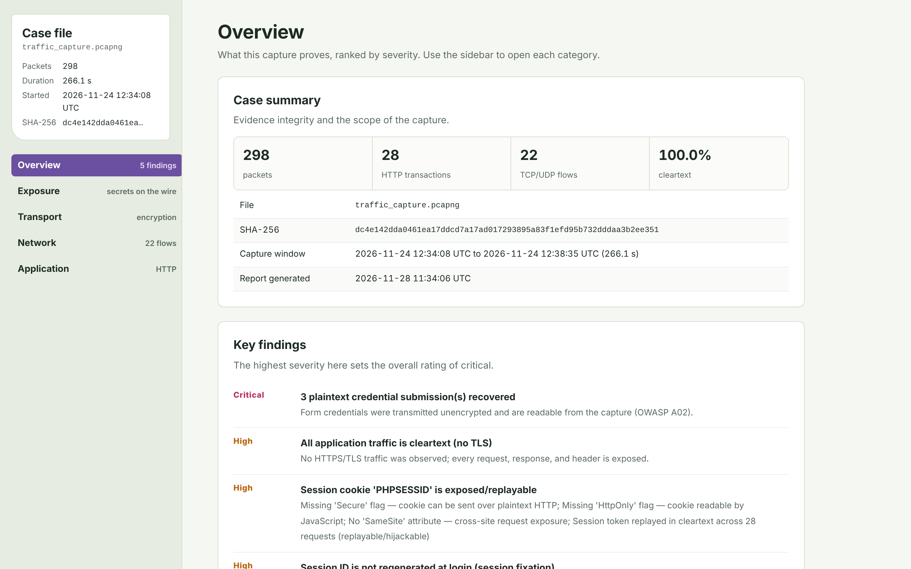

<sub>The tool's HTML evidence report, generated automatically from the lab capture.</sub>

</div>

---

## 📑 Contents

- [Key findings](#-key-findings)
- [What this project does](#-what-this-project-does)
- [Quick start](#-quick-start)
- [The tool: `pcap-triage`](#-the-tool-pcap-triage)
- [Investigation walkthrough](#-investigation-walkthrough-with-screenshots)
- [Reproducing the lab](#-reproducing-the-lab)
- [Testing & CI](#-testing--ci)
- [Repository structure](#-repository-structure)
- [Limitations & roadmap](#-limitations--roadmap)
- [Scope & ethics](#%EF%B8%8F-scope--ethics)

---

## 🚨 Key findings

The target web app (DVWA) runs entirely over **unencrypted HTTP**. A 4.4-minute capture (298 packets, 22 TCP streams, 28 HTTP transactions) was enough to show the following:

| # | Finding | Severity | Evidence |
|---|---------|----------|----------|
| 1 | **Administrator credentials** (`admin` / `password`) recovered in cleartext from the login POST | 🔴 Critical | Frame 18, Follow HTTP Stream |
| 2 | **No transport encryption**: 100% of application bytes are cleartext, with zero TLS sessions | 🟠 High | Protocol Hierarchy, triage tool |
| 3 | **Session token (`PHPSESSID`) exposed and replayable**: the same value is reused across 28 requests | 🟠 High | Frames 32 & 43 |
| 4 | The authenticated session cookie has **none** of `Secure` / `HttpOnly` / `SameSite` | 🟠 High | Cookie inspector, triage tool |
| 5 | **Full session hijack demonstrated**: the captured token alone logs an attacker in as `admin`, no password needed | 🔴 Critical | curl replay + browser cookie injection |
| 6 | **Session ID never rotated**: one `PHPSESSID` value survives three logins and a logout (session fixation, CWE-384) | 🟠 High | Triage tool, session-rotation check |

**Overall risk: CRITICAL.** Fix: serve everything over TLS 1.2+ with HSTS, set `Secure` + `HttpOnly` + `SameSite` on the session cookie, and regenerate the session ID at login.

---

## 🧭 What this project does

The project has two halves that support each other:

1. **Manual investigation (Wireshark / tshark).** Build an isolated lab, capture a scripted browsing session against DVWA, then analyse it the way an incident responder would. That covers the TCP handshake, the HTTP structure, credential and token exposure, request replay and session hijacking. Every claim is tied to a frame number and a screenshot.
2. **Automation (`pcap-triage`).** A pip-installable Python package that reproduces those findings on **any** capture, with no Wireshark needed. It reassembles TCP streams itself, runs a set of detectors, and writes evidence a SOC or SIEM can use directly.

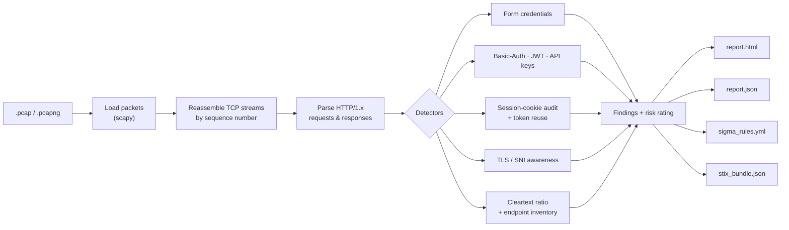

---

## ⚡ Quick start

**One command** (creates a virtualenv, installs, runs the tests, analyses the sample capture and opens the report):

```bash
git clone https://github.com/zainabthaa/network-forensics-toolkit.git
cd network-forensics-toolkit
./run.sh                         # or: ./run.sh path/to/your.pcapng
```

Outputs land in `out/`. To do the same steps by hand:

```bash

python3 -m venv .venv && source .venv/bin/activate     # Windows: .venv\Scripts\activate
pip install -e ".[dev]"

pcap-triage sample/traffic_capture.pcapng
open report.html                                        # Linux: xdg-open · Windows: start
```

**Requirements:** Python 3.9+. The only runtime dependencies are `scapy` and `jinja2`. Wireshark and tshark are **not** required to run the tool.

Expected console output:

```text
[*] Loading capture: sample/traffic_capture.pcapng
[*] 298 packets, 28 HTTP transactions
[+] JSON report  -> report.json
[+] HTML report  -> report.html
[+] Sigma rules  -> sigma_rules.yml
[+] STIX bundle  -> stix_bundle.json
[+] Flow records -> flows.csv

[=] Risk: CRITICAL | 3 form-cred(s), 0 basic-auth, 0 JWT(s), 0 API key(s), 1 session cookie(s), 100.0% cleartext, 0 TLS session(s)
[=] Network: 22 flow(s), 4 host(s), 266.107s, avg 10.6 kbit/s, peak 688.0 kbit/s, max 2 parallel connection(s)
```

---

## 🛠 The tool: `pcap-triage`

### What it detects

| Detector | Module | What it looks for |
|----------|--------|-------------------|
| Plaintext credentials | `detectors/credentials.py` | Username/password fields in URL-encoded POST bodies (`username`, `email`, `password`, `pwd`, …) |
| Auth artifacts | `detectors/auth.py` | HTTP Basic-Auth (decoded), JWTs in headers/cookies/bodies (header + payload decoded), API keys (named params and known patterns such as AWS, Stripe, GitHub, Slack, Google) |
| Session cookies | `detectors/cookies.py` | `PHPSESSID`, `JSESSIONID`, `connect.sid`, … audited for `Secure` / `HttpOnly` / `SameSite`, how many requests reuse the same token, and whether the ID is regenerated at login and invalidated at logout |
| Network profiling | `detectors/flows.py` | Bidirectional 5-tuple flow records (NetFlow-style CSV), Ethernet and IP conversation tables, an IP-to-MAC host inventory with TTL-based OS and hop inference, top talkers, protocol hierarchy, packet-size distribution, IO graph with activity bursts, a per-connection timeline, a session flow graph (sequence diagram), TCP health (handshake RTT, server response time, retransmissions, zero windows, SYN options, teardown type), and automatically generated analyst observations |
| TLS awareness | `detectors/tls.py` | Parses TLS ClientHello records to report the version and SNI of encrypted sessions, without decrypting anything |
| Traffic composition | `detectors/traffic.py` | Cleartext vs encrypted byte ratio, and a full endpoint inventory (method, path, hit count, status codes, form fields) |
| Stream reassembly | `detectors/pcap_http.py` | Per-direction TCP reassembly by sequence number (handles retransmissions/overlaps), HTTP message splitting by `Content-Length`, keep-alive request/response pairing |

Findings are ranked **CRITICAL → HIGH → MEDIUM**, and the highest one sets the overall risk level.

### Outputs

| File | Format | Used for |
|------|--------|----------|
| `report.html` | Dark-themed, self-contained HTML | Human review, demos, attaching to a case file |
| `report.json` | Machine-readable JSON | Scripting, diffing two captures, feeding other tools |
| `sigma_rules.yml` | [Sigma](https://sigmahq.io) rules, tagged with MITRE ATT&CK (T1040, T1557, T1550.004) | Detecting the same exposure in proxy/Zeek logs in any SIEM |
| `stix_bundle.json` | [STIX 2.1](https://oasis-open.github.io/cti-documentation/) bundle | Importing indicators (hosts, URLs, User-Agent) into a threat-intel platform |
| `flows.csv` | NetFlow-style flow records, one row per bidirectional flow | Spreadsheet analysis, loading into a flow/SIEM tool, comparing captures |

On the sample capture the tool produces **3 Sigma rules** and a **13-object STIX bundle**. Sample outputs are committed in [`evidence/`](evidence/).

<details>
<summary><b>Example: excerpt from <code>report.json</code></b></summary>

```json
{
  "risk_level": "CRITICAL",
  "credentials": [
    {
      "uri": "/login.php",
      "host": "192.168.128.20",
      "username": "admin",
      "password": "password",
      "all_fields": ["username", "password", "Login", "user_token"],
      "stream_id": 1
    }
  ],
  "session_cookies": [
    {
      "name": "PHPSESSID",
      "secure": false,
      "httponly": false,
      "samesite": null,
      "reuse_count": 28
    }
  ],
  "encryption": {
    "cleartext_bytes": 332761,
    "encrypted_bytes": 0,
    "cleartext_pct": 100.0,
    "verdict": "ALL traffic is unencrypted"
  }
}
```
</details>

<details>
<summary><b>Example: a generated Sigma rule</b></summary>

```yaml
title: Session Cookie Set Without Secure Attribute
status: experimental
description: Detects Set-Cookie responses for session identifiers that omit the Secure attribute, allowing transmission over HTTP.
author: pcap-triage
logsource:
    category: proxy
detection:
    selection:
        sc-set-cookie|contains:
            - 'PHPSESSID='
            - 'JSESSIONID='
            - 'SESSIONID='
    filter:
        sc-set-cookie|contains: 'Secure'
    condition: selection and not filter
level: medium
tags:
    - attack.credential_access
    - attack.t1550.004
```
</details>

<p align="center">
  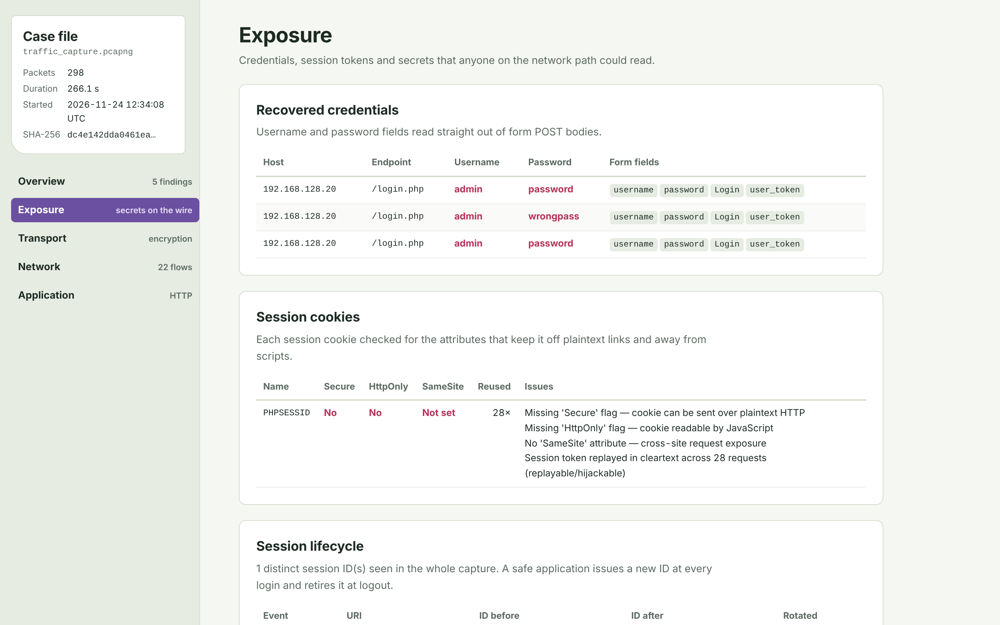<br>
  <sub>The report is a case file: the sidebar shows the capture's file name, packet count, duration, start time and SHA-256, and groups the evidence into Overview, Exposure, Transport, Network and Application. Each category opens on its own; long tables and the session flow graph show 15 rows and scroll for the rest.</sub>
</p>

### Network profile

The Network category profiles the capture as a network rather than a list of leaks.

<p align="center">
  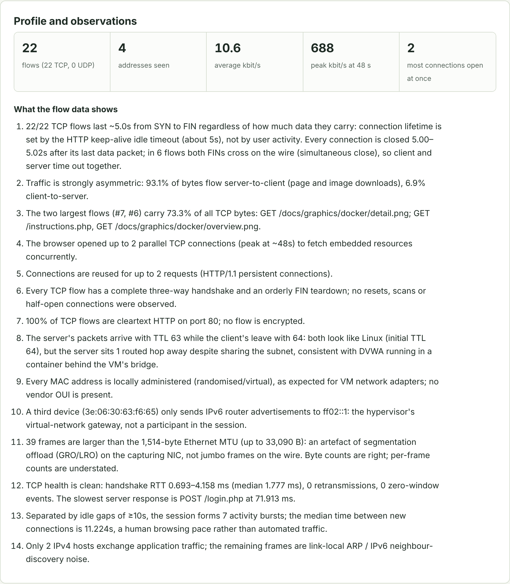<br>
  <sub>Profile and the observations the tool derives from the flow table.</sub>
</p>
<p align="center">
  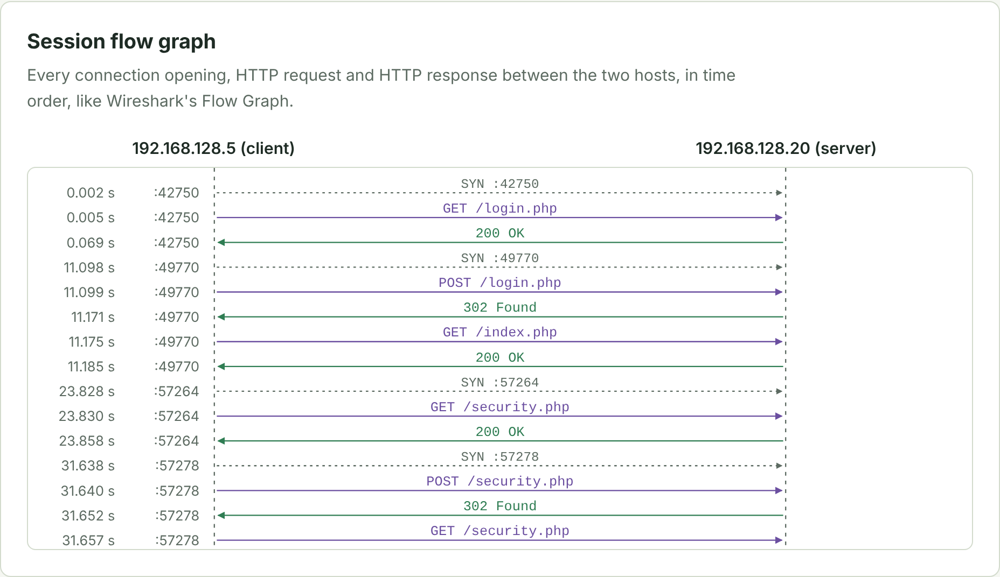<br>
  <sub>Session flow graph: every SYN, HTTP request and response between client and server (first 15 events; the box scrolls for the rest).</sub>
</p>

---

## 🔬 Investigation walkthrough (with screenshots)

The full write-up with 26 figures is in [`report/CS3093_Project_Report.pdf`](report/CS3093_Project_Report.pdf). These are the highlights.

### 1. Isolated lab and capture

Two VMs sit on a host-only segment with no route to the internet. The capture runs on the analyst's lab interface (`eth1`) **before** any browsing starts, so the full connection lifecycle is recorded.

<p align="center">
  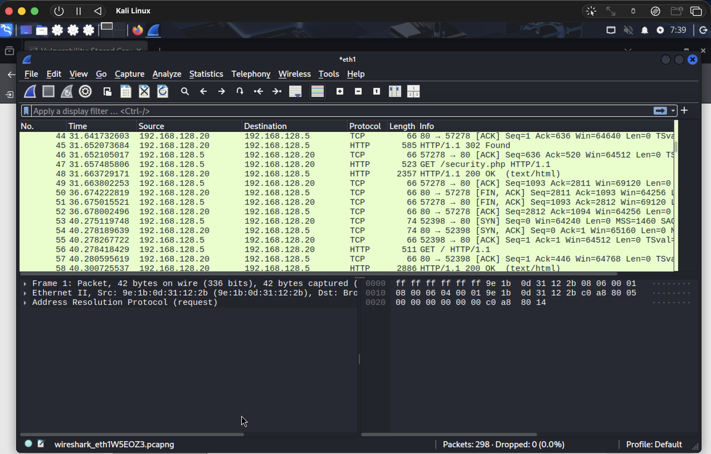<br>
  <sub>Live capture on eth1: 298 packets, 0 dropped.</sub>
</p>

### 2. Protocol picture and TCP handshake

The protocol hierarchy confirms the stack is Ethernet → IPv4 → TCP → HTTP, with **no TLS anywhere**. `tcp.stream == 0` isolates the three-way handshake (SYN → SYN-ACK → ACK, frames 3–5) that comes before the first HTTP GET.

<p align="center">
  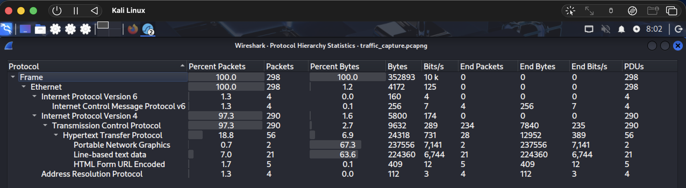<br>
  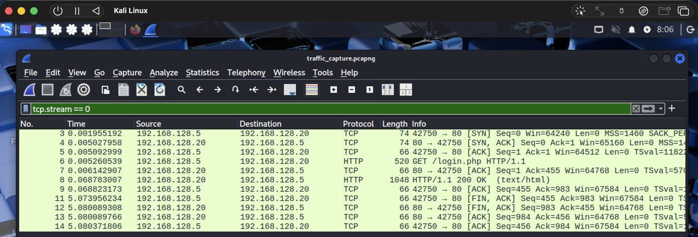<br>
  <sub>Top: protocol hierarchy, no TLS. Bottom: the SYN / SYN-ACK / ACK handshake on stream 0.</sub>
</p>

### 3. Scenario A: plaintext credentials

`http.request.method == "POST"` → Follow HTTP Stream on frame 18. The body contains `username=admin&password=password` in plain text. This is **OWASP A02:2021 – Cryptographic Failures**.

<p align="center">
  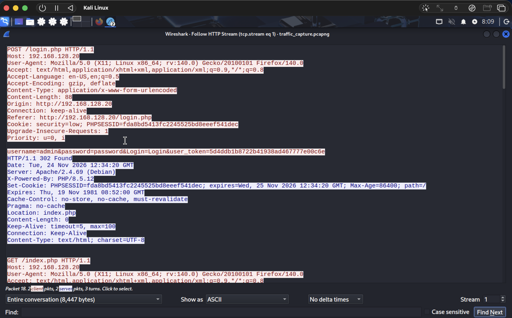<br>
  <sub>Credentials readable verbatim. No decryption needed.</sub>
</p>

### 4. Scenario B: session-token exposure

`http.cookie` shows the **same** `PHPSESSID` on every authenticated request (frames 32 and 43). The cookie issued after login has no `Secure`, `HttpOnly` or `SameSite`.

<p align="center">
  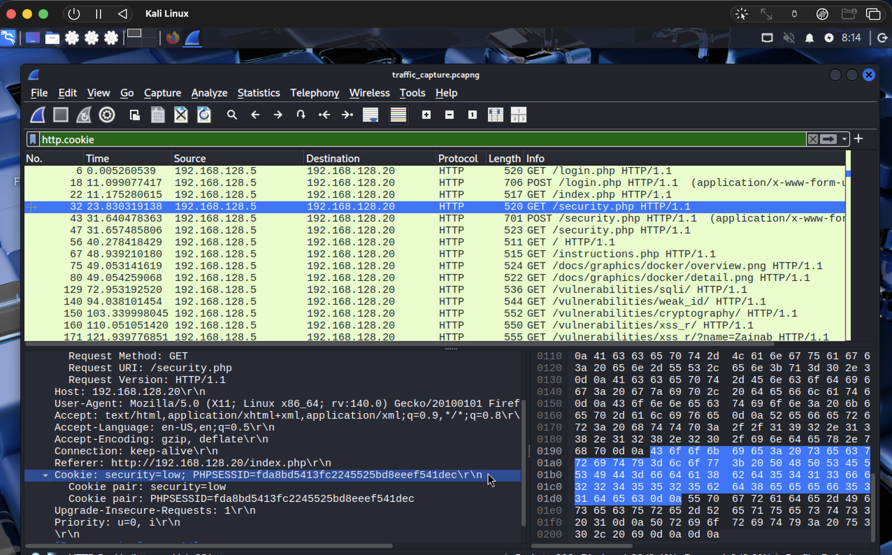<br>
  <sub>The static session token travels in cleartext on every request.</sub>
</p>

### 5. From exposure to exploitation: replay and hijack

**Request replay (curl).** Without a cookie the request gets `302 → login.php`. With the captured `PHPSESSID` it gets `200 OK` and the authenticated page.

<p align="center">
  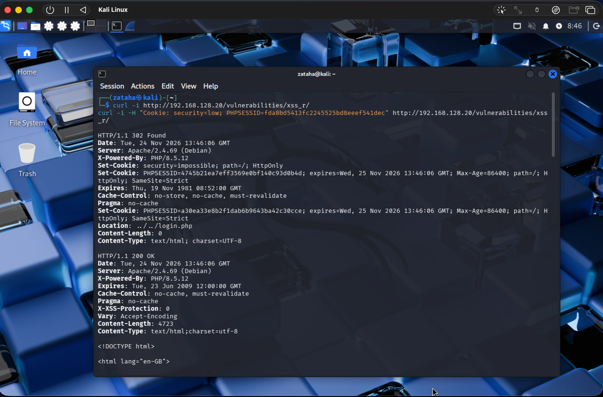
</p>

**Session hijack (browser).** The token is injected into a fresh private window that has no credentials. Reloading lands on the DVWA dashboard **as admin**.

<p align="center">
  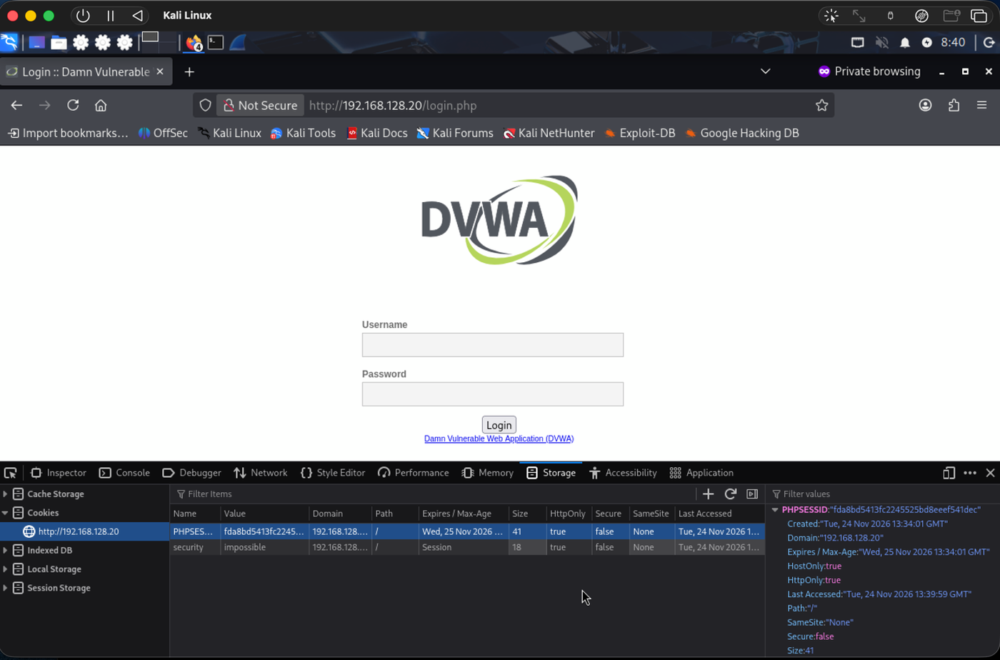
  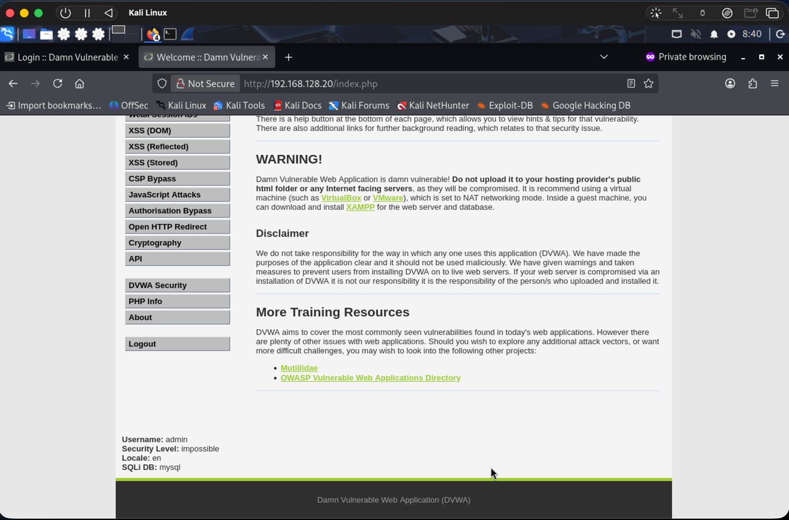<br>
  <sub>Left: the captured token injected via DevTools (Secure = false). Right: authenticated as admin, with no password used.</sub>
</p>

### Useful display filters

| Purpose | Filter |
|---------|--------|
| Analyst ↔ target conversation only | `ip.addr == 192.168.128.20 \|\| arp` |
| TCP handshakes | `tcp.flags.syn == 1` |
| A single connection | `tcp.stream == 0` |
| All HTTP | `http` |
| Form/credential submissions | `http.request.method == "POST"` |
| Session tokens | `http.cookie` |
| Hide residual IPv6 noise | `!ipv6` |

---

## 🧪 Reproducing the lab

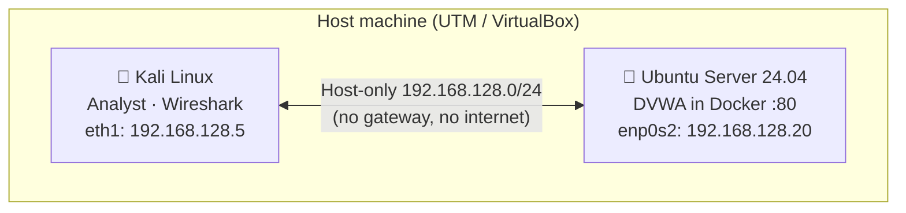

| Host | Role | OS | Lab IP (host-only) |
|------|------|----|--------------------|
| Kali | Analyst: capture & analysis | Kali Linux (ARM64) | `192.168.128.5/24` (eth1) |
| Ubuntu | Target: DVWA host | Ubuntu Server 24.04 + Docker | `192.168.128.20/24` (enp0s2) |

Each VM also has a separate NAT adapter, used **only** for installing packages. It carries no test traffic.

<details>
<summary><b>Step-by-step setup</b></summary>

1. **Create two VMs** (UTM, VirtualBox or VMware). Give each a host-only adapter on the same subnet, plus a NAT adapter for updates.
2. **Assign static IPs** on the host-only interfaces, then confirm with `ping` in both directions.

   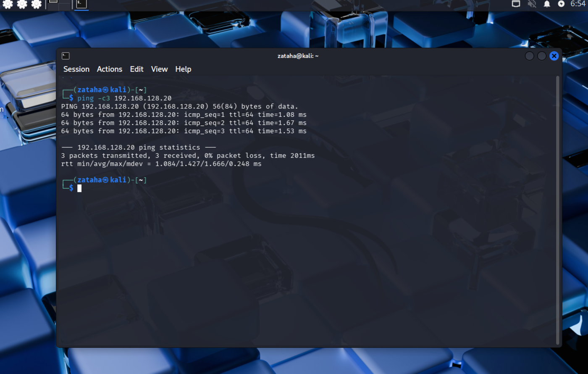
3. **Deploy DVWA** on the target:
   ```bash
   git clone https://github.com/digininja/DVWA.git && cd DVWA
   docker compose up -d          # publishes DVWA on 0.0.0.0:80
   ```
4. From Kali, open `http://192.168.128.20/login.php`, log in with `admin` / `password`, initialise the database, and set **Security → Low**.
5. **Start Wireshark on the lab interface first**, then browse: log in, visit 5+ pages, submit the guestbook (stored XSS), open reflected XSS, log out, and make one failed login. Keep going for 3–5 minutes.
6. Save as `traffic_capture.pcapng` and record its hash right away:
   ```bash
   sha256sum traffic_capture.pcapng
   ```
7. Run the triage tool on your capture and compare its output with your manual findings.

</details>

**Evidence integrity.** SHA-256 of `traffic_capture.pcapng`:
`dc4e142dda0461ea17ddcd7a17ad017293895a83f1efd95b732dddaa3b2ee351`

Verify it with:

```bash
sha256sum sample/traffic_capture.pcapng        # macOS: shasum -a 256
```

---

## ✅ Testing & CI

```bash
python -m pytest -q
# ......................                                       [100%]
# 22 passed
```

The suite runs against the bundled capture and checks the following:
- the packet and HTTP-transaction counts (298 / 28)
- that `admin` / `password` is recovered
- that `PHPSESSID` is flagged insecure and reused
- the 100% cleartext ratio
- the endpoint inventory
- that the auth and TLS detectors run
- that the Sigma and STIX exports are valid
- the end-to-end CRITICAL rating
- flow records (22 TCP flows, every frame accounted for, all handshakes complete), top talkers, protocol hierarchy, IO timeline and the NetFlow CSV export
- conversations, the host inventory (server one hop away), TCP health, activity bursts, the session flow graph, and that the HTML report renders every section
- that the session ID is detected as never rotated

**GitHub Actions** ([`ci.yml`](.github/workflows/ci.yml)) installs the package, runs the tests and smoke-tests the CLI on every push and pull request, on **Python 3.9, 3.10, 3.11 and 3.12**.

---

## 📁 Repository structure

```text
network-forensics-toolkit/
├── pcap_triage/                  # the tool (installable package)
│   ├── cli.py                    # pipeline, findings, risk rating, console entry point
│   ├── detectors/
│   │   ├── pcap_http.py          # TCP reassembly + HTTP parsing
│   │   ├── credentials.py        # plaintext form credentials
│   │   ├── auth.py               # Basic-Auth, JWT, API keys
│   │   ├── cookies.py            # session-cookie audit, token reuse, ID rotation
│   │   ├── flows.py              # 5-tuple flows, top talkers, IO graph, profiling
│   │   ├── tls.py                # ClientHello / SNI parsing
│   │   └── traffic.py            # cleartext ratio + endpoint inventory
│   ├── exporters/
│   │   ├── sigma.py              # Sigma rule generation
│   │   └── stix.py               # STIX 2.1 bundle generation
│   └── templates/report.html.j2  # HTML report template
├── tests/test_detectors.py       # pytest suite
├── sample/traffic_capture.pcapng # the lab capture
├── evidence/                     # capture + the tool's rendered outputs
├── report/                       # full project report (PDF + DOCX)
├── docs/screenshots/             # images used in this README
├── .github/workflows/ci.yml      # CI pipeline
├── run.sh                        # one command: install, test, analyse, open report
├── pyproject.toml                # packaging; `pcap-triage` entry point
└── requirements.txt
```

---

## 🧱 Limitations & roadmap

**Current limitations** (honest scope):
- Supports HTTP/1.x only. Bodies are framed by `Content-Length`, so chunked transfer encoding and HTTP/2 are not parsed yet.
- TLS traffic is identified (version and SNI), not decrypted.
- Credential detection covers URL-encoded forms, not JSON or multipart bodies.

**Planned:**
- [ ] Chunked-encoding and JSON-body support
- [ ] Optional TLS decryption with an `SSLKEYLOGFILE`
- [ ] Synthetic test PCAPs for the Basic-Auth / JWT / API-key detectors
- [ ] Forensic timeline view in the HTML report

---

## ⚖️ Scope & ethics

All work was done in an **isolated host-only lab** against a **deliberately vulnerable** application (DVWA). No live, production or third-party systems were touched. The credentials shown are DVWA's public defaults. This project is for educational, defensive and forensic learning only. Only capture traffic on networks you own or are authorised to test.

---

## 👥 Authors

- **Zainab Taha**: [GitHub @zainabthaa](https://github.com/zainabthaa)
- **Natali Soukh**

Built for **CS3093 — Cryptography**, Effat University, Fall 2026.

## 📄 License

MIT. See [`pyproject.toml`](pyproject.toml).
